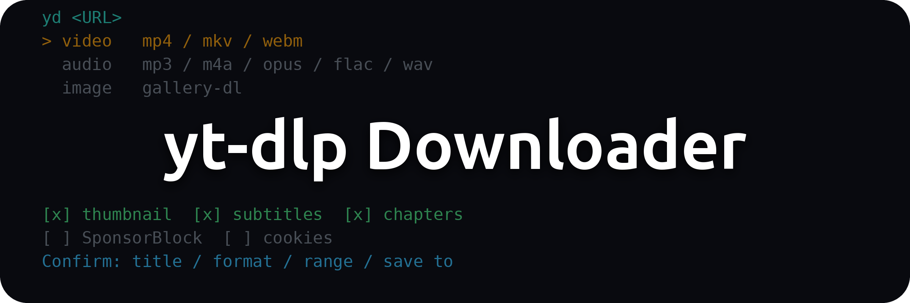

<div align="center">

<p align="center">
  
</p>

<p align="center"><b>English</b> | <a href="README.ja.md">日本語</a></p>

<h1 align="center">yt-dlp Downloader</h1>

<h3 align="center">Download video, audio and images from an fzf menu.</h3>

<p align="center">A launcher (<code>yd</code>) that drives <a href="https://github.com/yt-dlp/yt-dlp">yt-dlp</a> from an fzf menu. Paste a URL, pick the format, quality, range and options, check the confirmation screen, and start the download.</p>

<p align="center">
  <a href="https://www.npmjs.com/package/@lapius/ytdlpdownloader"></a>
  <a href="https://github.com/Lapius7/ytdlpdownloader/actions/workflows/release.yml"></a>
  <a href="LICENSE"></a>
  <a href="https://github.com/Lapius7/ytdlpdownloader/stargazers"></a>
  <a href="https://github.com/Lapius7/ytdlpdownloader/commits/main"></a>
</p>

<p align="center">
  <a href="#quick-start">Quick start</a> ·
  <a href="#usage">Usage</a> ·
  <a href="#requirements">Requirements</a> ·
  <a href="#release">Release</a>
</p>

</div>

## Overview

Works with YouTube and the other sites yt-dlp supports (Niconico, X, TikTok, Instagram, Twitch and thousands more), plus image sites supported by [gallery-dl](https://github.com/mikf/gallery-dl).

## Quick start

```bash
pnpm add -g @lapius/ytdlpdownloader     # the command is yd
```

It can also be installed from [lapacks](https://github.com/Lapius7/lapacks). Then run `yd`.

### Requirements

| | |
|-|-|
| Required | `zsh`, `yt-dlp`, `fzf` (0.63 or later), `ffmpeg`, `jq` |
| Used if present | `gallery-dl` (image posts), `chafa` (thumbnail preview), `fd`, `eza` |

Checked on Linux and WSL; macOS is supported on a best-effort basis (not verified for this README). If something is missing, the install hint is shown at startup.

## Usage

```bash
yd                      # open the menu
yd <URL>                # pass a URL, then choose video / audio / image
yd video [URL]          # video (mp4 / mkv / webm)
yd audio [URL]          # audio (mp3 / m4a / opus / flac / wav)
yd image [URL]          # thumbnails and image posts (switches to gallery-dl automatically)
yd batch [URL...|file]  # several URLs at once
yd history              # history of saved files
yd update               # update yt-dlp
yd --version
```

Keys: ↑↓ / j k to move, Enter to confirm, Esc to go back, Ctrl+C to abort a download. Without a URL, the URL in the clipboard is used.

### Options (multi-select with Space)

| Type | Choices |
|-|-|
| Video | Embed or save the thumbnail, subtitles (embedded, separate, auto-generated), chapters, metadata, SponsorBlock |
| Audio | Embed or save the cover image, metadata, chapters, SponsorBlock |
| Image | All thumbnail sizes, use gallery-dl |
| Common | Save the description, skip already downloaded files (archive), speed limit, cookies |

The options you pick are remembered per type and become the defaults next time. After setup, a confirmation screen (title, format, range, options, save location) lets you fix each item or copy the command that will run.

### Sites that need a login

Choose "Cookie" in the options, or the menu shown on failure, and select a `cookies.txt` file or a browser (Firefox, Chrome and others). On WSL, cookies of Chrome/Edge on the Windows side cannot be read, so use a Firefox profile or `cookies.txt`.

## Files

- Settings, history, archive: `~/.config/yd/`
- Logs: `~/.yd_logs/`
- Temporary files: `~/.cache/yd/`

## Release

Pushing a `v*` tag runs GitHub Actions (`.github/workflows/release.yml`), which publishes to npm with `npm/build.mjs` (it authenticates with a Trusted Publisher, so no token is needed). To check locally: `node npm/build.mjs 0.0.0-dev --pack`.

> [!NOTE]
> The README images are drawn from the menu text and are not screenshots of `yd`. Behavior described here was carried over from the previous README and has not been re-run for this rewrite.

## License

[MIT](LICENSE)
